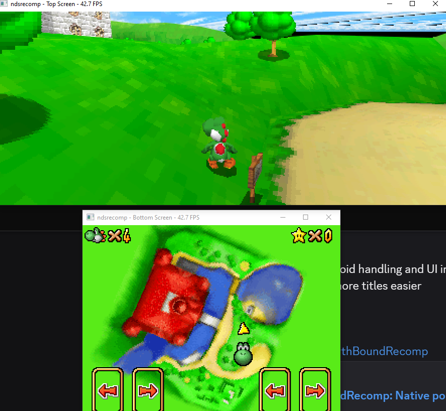

# SuperMario64DSRecomp

> Super Mario 64 DS Recomp `0.0.3` is an in-development public preview.
> Bugs are expected. This is not a finished port, a general Nintendo DS
> emulator, or a compatibility promise for every course, cutscene, overlay, or
> save-path edge case.

Early Super Mario 64 DS static-recompilation target for
[ndsrecomp](https://github.com/mstan/ndsrecomp). It recompiles and
host-compiles the European game's ARM9 and ARM7 code banks, boots through the
authentic BIOS/firmware/cartridge path, and reaches controllable castle-grounds
gameplay with adaptive top-screen 21:9 presentation.

No Nintendo ROM, BIOS, firmware, save data, extracted image, generated C
source, raw capture, or generated bank belongs in Git or release artifacts.
The local ROM and generated outputs are intentionally ignored.

## Current Status

Version `0.0.3` is a public Windows development preview for the exact
European revision-0 ROM identified below. The Windows ZIP contains the
ROM-free recomp-ui launcher, exact-ROM title runner, launcher assets,
configuration, documentation, and required runtime libraries.

The game is playable enough to demonstrate castle-grounds control and the
adaptive top-screen renderer. Known issues remain, including rough performance
in fallback-heavy areas, incomplete title coverage outside validated routes,
and visible 21:9 edge artifacts in some camera angles. File A is the current
fast path into gameplay for local testing.

## Quick Start

1. Download and fully extract
   `SuperMario64DSRecomp-windows-x64-v0.0.3.zip` from
   [Releases](../../releases).
2. Put your legally obtained European revision-0 `Super Mario 64 DS.nds` ROM
   next to `SuperMario64DSRecomp.exe`, or select it when prompted.
3. Run `SuperMario64DSRecomp.exe`.

The launcher remembers the ROM selection. The runner independently verifies
the ROM before executing any title bank. Retail BIOS and firmware dumps are
optional: if all three are present in `bios`, the launcher uses them; otherwise
it falls back to bundled FreeBIOS code banks and generated firmware.

## Showcase



The Adaptive Widescreen mod renders the upper 3D screen as a 448x192 21:9
surface while the lower touchscreen stays native and clickable in its own
window.

## Verified Cartridge

The project is pinned to the European revision-0 retail build used by the
online decomp:

| field | value |
|---|---|
| file | `Super Mario 64 DS.nds` (Git-ignored) |
| title | `S.MARIO64DS` |
| game code | `ASMP` |
| revision | 0 |
| size | 16 MiB |
| SHA-1 | `1367529f2cb23e76ef295cb1727333ae8f0a6cd7` |
| SHA-256 | `ce5829aaa79f06c67140ed1f45cbca738b0a9d0180538c8c1498472d859db032` |

## Decomp-Assisted Recompilation

[`tangosdev/sm64ds-decomp`](https://github.com/tangosdev/sm64ds-decomp) is
pinned in `sm64ds-decomp.pin`. Its original MIT-licensed work supplies exact
European ARM9 function names, modes, sizes, and module boundaries. This
project uses that metadata; it does not compile the decomp's matched C or copy
it here.

`tools/prepare_sm64ds.py` verifies the local ROM, decompresses its ARM9 image,
and generates ignored ndsrecomp configs. The build then:

- recompiles all decomp-defined ARM9 main-module functions;
- discovers and recompiles the initial ARM7 boot closure;
- optionally compiles captured, content-validated ARM7 and ARM9 runtime-RAM
  banks when the ignored local capture images exist;
- links those banks into the ROM-gated `nds_runner.exe`.

Every ROM-derived output lives under ignored `generated/` and is never
suitable for source control or release artifacts.

## Setup and Build

Initialize the framework submodule and pinned decomp checkout, then install
`ndspy` in the checkout's local virtual environment:

```powershell
git submodule update --init --recursive
git clone https://github.com/tangosdev/sm64ds-decomp.git third_party/sm64ds-decomp
git -C third_party/sm64ds-decomp checkout --detach 3b7450212bf0fae706a3be9bbd2d31d5c588b54f
py -3.12 -m venv third_party/sm64ds-decomp/.venv
third_party/sm64ds-decomp/.venv/Scripts/python.exe -m pip install ndspy
```

Place the verified ROM at `Super Mario 64 DS.nds`, then configure and build:

```powershell
cmake -G Ninja -S . -B build
cmake --build build --target supermario64dsrecomp
```

To run through the shared title runner:

```powershell
cmake -G Ninja -S ndsrecomp/runner -B ndsrecomp/runner/build-sm64-native `
  -DNDS_BOOTSTRAP_FIRMWARE=ON `
  -DNDS_TITLE_BANK_DIR="$PWD/generated/recomp" `
  -DNDS_TITLE_ROM_SHA1=1367529f2cb23e76ef295cb1727333ae8f0a6cd7
cmake --build ndsrecomp/runner/build-sm64-native -j 12

ndsrecomp/runner/build-sm64-native/nds_runner.exe ndsrecomp/bios `
  --interactive --rom "Super Mario 64 DS.nds" --config game.toml `
  --screen-layout separate --adaptive-widescreen top
```

## Release Packaging

The supported Windows release path builds the ROM-free runner and launcher,
then packages the portable ZIP:

```powershell
powershell.exe -NoProfile -ExecutionPolicy Bypass -File `
  tools\build-windows.ps1 -Version 0.0.3
```

On Linux, build the runner-first AppImage from source:

```bash
bash tools/build-linux.sh --version 0.0.3
```

The packagers validate the CMake version and framework pin, refuse a runner
without the SM64DS title banks, stage only explicit safe payloads, and reject
unsafe names or ROM/save/BIOS/firmware/generated material. The Linux AppImage
starts `nds_runner` directly because the current title launcher is
Windows-only; place the `.nds` ROM and a `bios/` folder containing your
verified DS dumps beside the AppImage.

## Current Boot Boundary

The fake direct-boot shortcut remains deliberately unused. ndsrecomp models
the physical-card command path used by the firmware, including chip identity,
ROM streaming, DMA, KEY1 commands, and normalization of already-decrypted ROM
secure areas before the BIOS decrypts them.

The title configuration uses the original firmware's Automatic startup mode,
so an inserted SM64DS cartridge launches without a host-simulated menu click.
This only changes the redundant user-setting copies and their CRCs in memory;
use `--startup-mode manual` when testing the DS menu itself.

Rendering defaults to Automatic, which prefers the OpenGL 4.3 compute backend
and uses its direct GPU-resident top-window path where supported. Automatic
mode falls back to the faithful threaded software renderer if OpenGL cannot
initialize; an explicitly selected OpenGL backend fails loudly instead.

The tested local target passes the firmware menu, launches both game CPUs,
renders the Nintendo splash, accepts the game's `TOUCH TO START` input, and
reaches castle-grounds gameplay without a terminal dispatch miss or CPU stall.
The lower-screen renderer includes text, affine, and extended tiled/bitmap
backgrounds, including SM64DS's courtyard minimap and its extended palette.

The castle skybox remains a known 21:9 limitation: some widened camera angles
can expose black voids or stretched peripheral sky. Future model-aware or
decomp-side work is required for a complete visual fix.

## Copyright and Licensing

The original code in this scaffold is released under the MIT License; see
[`LICENSE`](LICENSE). This grant covers only this repository's own source. The
`ndsrecomp` submodule, upstream references, and optional third-party checkout
retain their respective terms and are not relicensed by it. Curated
screenshots may be included to show current behavior; the game ROM, BIOS,
firmware, saves, generated code, raw captures, and dumped game material are
not distributed.
